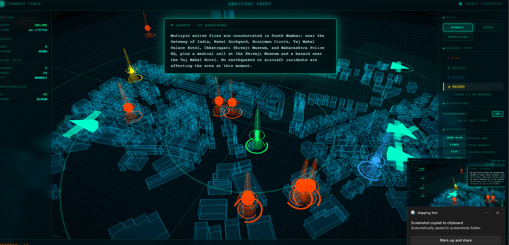

<div align="center">

# 🎯 Emergency Command Table

### Touchless 3D command interface for emergency operations

**Control a real 3D map of Mumbai with hand gestures and voice.**
**An LLM reasons over live marker data to give tactical recommendations.**

[](https://python.org)
[](https://threejs.org)
[](https://mediapipe.dev)
[](LICENSE)

[](https://lnkd.in/p/dpkrpRsh) · [**⚡ Quick Start**](#-quick-start)

</div>

---

<p align="center">
  
</p>

<div align="center">
<i>The full command table: live 3D map of Mumbai, AI reasoning panel, HUD telemetry, live aircraft + earthquake tracking.</i>
</div>

---

## 📌 The 30-Second Pitch

Emergency operators — firefighters, hazmat crews, medical teams — often **can't touch a keyboard or shared screen**. They wear gloves. They hold radios. They work in sterile environments.

This project asks: **can a touchless spatial interface work on commodity hardware?**

The answer is yes. This is a working prototype that runs on any laptop webcam.

**You control a 3D map of Mumbai with:**
- ✋ **Hand gestures** — rotate, place, delete, zoom
- 🎙️ **Voice commands** — filter, navigate, query
- 🧠 **AI reasoning** — *"Where should I send the ambulance?"* → tactical answer

No AR headset. No depth sensor. No special hardware.

---

## 🔥 What Makes This Hard

This isn't a tutorial clone. Every layer required real engineering:

| Challenge | Solution |
|---|---|
| **Hand tremor fires 10 markers per pinch** | Custom `RELEASED → PRESSING → FIRED` state machine with 200ms hold requirement |
| **Fist gesture reads as pinch** | Reordered detection: check all-fingers-curled *before* thumb-index distance |
| **MediaPipe output flickers between frames** | 4-frame sliding window stabilization |
| **LLM answers with map coordinates, not names** | Real GPS conversion + landmark database for 3 cities |
| **Earthquakes 5,000 km away map off-screen** | Square-root distance compression (direction exact, distance scaled) |
| **Whisper hallucinates words on silence** | Auto-calibrated ambient noise floor + repetition filter |
| **WASAPI mic returns silence on Windows** | Device enumeration across 12 combinations to find the working one |
| **Bloom blows up markers into orange blobs** | Parameter tuning: strength 1.35→0.40, threshold 0.15→0.75 |

**Real-time CV + real-time 3D + real-time LLM — all running at 90+ FPS on a laptop.**

---

## 🎬 Demo

### Gesture Control

| Action | Result |
|---|---|
| Open palm + move | Rotate 3D map |
| Pinch thumb + index | Drop marker (FIRE / MEDICAL / POLICE / HAZARD) |
| Fist on marker | Delete marker |
| Two hands spread | Zoom in / out |
| Hover over marker 0.6s | Info panel with live weather |

### Voice + AI

You: "JARVIS, which area did the fire happen in?"

AI: "The fire is near Chhatrapati Shivaji Museum, 166m east.
Medical unit is standing by near St. Thomas Cathedral."


**No coordinates. Real landmarks. Real directions. Real reasoning.**

---

## 🏗️ Architecture
┌─────────────────────────────────────────────────────────────────┐
│ LOCAL MACHINE │
│ │
│ ┌────────┐ ┌──────────────┐ ┌─────────────────┐ │
│ │ Webcam ├───▶│ hand_tracker │───▶│ WebSocket │ │
│ └────────┘ │ (MediaPipe) │ │ :8765 (30 Hz) │ │
│ └──────────────┘ └────────┬────────┘ │
│ │ │
│ ┌────────┐ ┌──────────────┐ │ │
│ │ Mic ├───▶│ jarvis │ │ │
│ └────────┘ │ (Whisper) │ │ │
│ └──────┬───────┘ │ │
│ │ │ │
│ ▼ │ │
│ ┌──────────────┐ │ │
│ │ llm_engine │ │ │
│ │ (Groq LLM) │ │ │
│ └──────┬───────┘ │ │
│ │ │ │
│ ┌──────────────┐ │ │ │
│ │ live_data │ │ │ │
│ │ (OpenSky) │ │ │ │
│ ├──────────────┤ │ │ │
│ │ earthquake │ │ │ │
│ │ (USGS) │ │ │ │
│ └──────┬───────┘ │ │ │
│ └──────┬──────┘ │ │
│ └────────────────────────────┘ │
│ │ │
│ ▼ │
│ ┌──────────────────┐ │
│ │ Browser │ │
│ │ (Three.js) │ │
│ │ · 3D map │ │
│ │ · HUD │ │
│ │ · AI panel │ │
│ └──────────────────┘ │
└──────────────────────────────────────────────────────
────────────┘

**Design principle:** Python handles *perception and reasoning*. The browser handles *rendering and interaction*. They communicate over a single 30 Hz WebSocket with negligible overhead.

---

## 🛠️ Tech Stack

<table>
<tr>
<td valign="top" width="33%">

**Perception**
- MediaPipe (hand tracking)
- OpenCV (frame capture)
- Custom state machines

</td>
<td valign="top" width="33%">

**Intelligence**
- Faster-Whisper (STT)
- pyttsx3 (TTS)
- Groq `gpt-oss-120b` (LLM)

</td>
<td valign="top" width="33%">

**Data & Rendering**
- Three.js (WebGL)
- OpenStreetMap + OSMnx
- OpenSky · USGS · Open-Meteo

</td>
</tr>
</table>

---

## ⚡ Quick Start

### Requirements
- Python **3.11** (MediaPipe doesn't support 3.12+ yet)
- Webcam + microphone
- Windows / macOS / Linux

### Install

```bash
git clone https://github.com/ymanoj7745-lgtm/emergency-command-table.git
cd emergency-command-table

python -m venv venv
venv\Scripts\activate                    # Windows
# source venv/bin/activate               # Mac/Linux

pip install -r requirements.txt

Get a Free API Key
Sign up at console.groq.com (no card required)

copy .env.example .env       # Windows
# cp .env.example .env       # Mac/Linux

Paste your key into .env:
GROQ_API_KEY=gsk_your_actual_key


Fetch Map Data (one-time, 2-3 min)
python fetch_map.py
Downloads real building footprints from OpenStreetMap for Mumbai, Delhi, and Bangalore.

Run
Windows: Double-click run.bat

Manual:
# Terminal 1
python -m http.server 8000

# Terminal 2
python hand_tracker.py

open http://localhost:8000/index.html in chrome or edge 

---------------------------------------------------
📁 Project Structure
emergency-command-table/
├── hand_tracker.py        Main loop, gesture detection, WebSocket server
├── jarvis.py              Voice input, intent parsing, TTS
├── llm_engine.py          Groq integration + context building
├── landmarks.py           Real-world landmark lookup (Mumbai/Delhi/Bangalore)
├── live_data.py           OpenSky aircraft feed
├── earthquake_data.py     USGS earthquake feed
├── markers_store.py       JSON persistence
├── fetch_map.py           OSM → JSON downloader
├── index.html             Three.js scene + HUD + AI panel
├── run.bat                One-click Windows launcher
├── requirements.txt
├── .env.example
└── *_buildings.json       Real OSM data per city


🎯 Key Engineering Decisions
<details> <summary><b>1. Why Python for perception but browser for rendering?</b></summary>
Each language used where its ecosystem is strongest. Python has MediaPipe, Whisper, OSMnx, and the Groq SDK. JavaScript has Three.js — the mature WebGL library. WebSocket at 30 Hz has negligible overhead, so the split works cleanly.

</details><details> <summary><b>2. Why a state machine for pinch, not a distance threshold?</b></summary>
Hand tremor causes pinch_distance to oscillate above and below any threshold. A raw threshold fired ~10 markers per physical pinch. The state machine (RELEASED → PRESSING → FIRED) with a 200ms hold requirement fires exactly one marker per deliberate pinch.

</details><details> <summary><b>3. Why rule-based intent parsing for commands and LLM for questions?</b></summary>
Discrete commands ("show fire markers", "zoom in") run through regex — instant, 100% reliable, no API cost. Open-ended questions ("what should I do?") go to the LLM. Each tool used where it's strongest.

</details><details> <summary><b>4. Why square-root distance compression for earthquakes?</b></summary>
A magnitude 6.0 earthquake 5,000 km away would map 5,000 units off a 50-unit grid — completely invisible. The sqrt compression maps it to ~42 units. Direction stays exact. Distance is visually compressed. The user still sees where it is, just not at true scale.

</details><details> <summary><b>5. Why real landmarks instead of raw coordinates?</b></summary>
The LLM originally answered "the fire is at (3.0, -1.0)" — technically correct but tactically useless. The landmarks.py module converts map coordinates → real GPS → nearest named landmark. Now the AI answers "near Chhatrapati Shivaji Museum, 166m east." That's an operations briefing, not a debugging log.

</details>
📊 Performance
Metric	Value
3D render FPS	90-120
WebSocket update rate	30 Hz
MediaPipe inference	~15 ms/frame
Pinch → marker drop	~80-150 ms
Voice round trip (Whisper + LLM + TTS)	4-7 s
Memory usage	~800 MB
CPU usage	40-60%
⚠️ Limitations
Engineering judgment includes knowing what's missing.

Map covers ~1.3 km² per city, not entire cities (would need tile streaming)

Building heights estimated from OSM building:levels tags, not surveyed

Whisper accuracy ~85% on accented English

Voice latency 4-7s (Whisper + LLM + TTS pipeline)

Chennai excluded (Overpass API timeouts during development)

No multi-user support, no authentication

Not field-tested with real emergency operators

Localhost only — deployment limited to static visual demo

🧠 What I Learned
Real-time CV on commodity hardware — MediaPipe runs at 60+ FPS on CPU with no GPU

State machines > thresholds for any noisy continuous signal

Reasoning models need different token parameters — gpt-oss-120b burns ~500 tokens on hidden thinking before visible output

Hardware is the hardest part — spent more time debugging Windows audio drivers than building the gesture engine

Real data beats synthetic — using actual Mumbai buildings and landmarks made the demo instantly convincing

Multimodal UX is architecture — voice, gesture, and keyboard need clear boundaries for when each is used

🗺️ Roadmap
☑ Hand gesture recognition (palm, pinch, fist, zoom)
☑ Voice commands (Whisper + intent parser)
☑ LLM reasoning over live map state
☑ Real OSM building data (Mumbai, Delhi, Bangalore)
☑ Live aircraft tracking (OpenSky)
☑ Live earthquake feed (USGS)
☑ Marker persistence
☑ Multi-city switching
□ Path drawing (pinch-drag evacuation routes)
□ Multi-user collaboration
□ Deployment to Vercel (static demo)
□ Full city coverage (Cesium or Mapbox GL)
📜 License
MIT — see LICENSE

🙏 Acknowledgements
MediaPipe — production-grade hand tracking on CPU

OpenAI Whisper — speech recognition

Groq — extremely fast LLM inference

OpenStreetMap — the free map of the world

OSMnx — Python library for OSM

OpenSky Network — free real-time flight data

USGS — earthquake feed

Open-Meteo — free weather API

Three.js — WebGL made sane

<div align="center">
Built as a research prototype to explore touchless spatial interfaces on commodity hardware.

The interaction model is validated. The perception and reasoning layers are production-ready.

⭐ If you found this interesting, a star helps others find it too.

</div> ```
